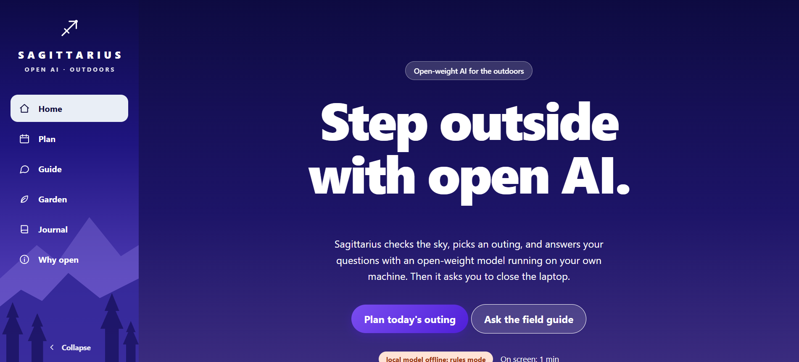

# Sagittarius

**Step outside with open AI.**

Sagittarius is a local-first outdoor companion that runs in a single HTML file. It checks the sky, plans an outing, answers field questions with an open-weight model running on your own machine, and then asks you to close the laptop. The screen should be the shortest part of the experience.

Built for the **Touch Grass** open-source AI challenge.




## Features

- **Outing planner**: gets the forecast for your location (temperature, rain chance, wind, UV, sunrise and sunset) and gives a plan for a hike, run, birding trip, foliage photography, gardening, a picnic or a walk. It works from simple built-in rules, and when the local model is running it writes a fuller plan.
- **Field guide chat**: streaming chat with any open-weight model served by [Ollama](https://ollama.com) (Gemma is picked by default if installed). Ask about a bird call, a plant, trail safety or what to pack.
- **Garden planner**: enter your average last spring and first fall frost dates (or choose a season if you have no frost) and see what to sow this week. Works fully offline.
- **Field journal**: notes and photos saved in your browser only. Photos are shrunk before saving.
- **Outdoor timer and screen clock**: shows how long you have been on screen, and logs the minutes you spend outside.
- **Media holders**: the field guide and "Why open" sections accept your own background video or image (upload a file or paste a URL).
- **Light mode UI** with a collapsible sidebar and section highlighting.

## Why open-weight

- **Works with no signal.** The model runs on your laptop through Ollama. Only the optional weather lookup needs internet.
- **Your places stay yours.** Prompts go to `localhost`. Your locations and journal never leave your device.
- **Swap or tune the model.** The model menu lists whatever you have pulled (Gemma, Llama, Qwen and others). You can change the system prompt in `sagittarius.html`, or fine-tune a model on your regional species list.
- **Costs nothing to run.** No API keys, accounts or per-token fees.

## Quick start

1. Install [Ollama](https://ollama.com).
2. Pull a model:
   ```bash
   ollama pull gemma3
   ```
3. Start Ollama so the page is allowed to call it:
   ```bash
   # macOS / Linux
   OLLAMA_ORIGINS="*" ollama serve

   # Windows (PowerShell)
   $env:OLLAMA_ORIGINS="*"; ollama serve
   ```
4. Open `sagittarius.html` in your browser. The status badge in the hero shows `local model ready` when it connects.

No build step and no dependencies.

If Ollama is not running, the planner and garden tools still work using built-in rules, and the badge shows `local model offline: rules mode`.

## Usage

| Section | What to do |
| --- | --- |
| Plan | Click **Use my location** (or type latitude and longitude), pick an activity and the time you have, then **Check the sky and plan**. Press **Start outdoor timer** when you head out. |
| Guide | Choose a model, type a question and press **Ask**. |
| Garden | Enter frost dates or pick a season, then **Show this week's plantings**. |
| Journal | Add a place, a note and an optional photo, then **Save entry**. |

## Customising

- **Model behaviour**: edit the `system` message inside the `llm()` function in `sagittarius.html`.
- **Crops**: edit the `SPRING`, `FALL` and `MEDIT` arrays in the garden section. Each spring entry is `[crop, earliest week, latest week]` relative to the last frost.
- **Colours**: change the CSS variables at the top of the `<style>` block (`--ink`, `--sun`, `--coral`, `--mist`, `--side`).
- **Backgrounds**: use the **Set video or image** button on a section. URLs are remembered in your browser; files you pick from disk apply for the current session only.

## Data and privacy

- Journal entries, frost dates, outdoor-time logs and sidebar state are stored in your browser's `localStorage`.
- The only network request the page makes by itself is the weather lookup to [Open-Meteo](https://open-meteo.com) (free, no key), which is sent your latitude and longitude. Skip it by entering conditions by hand.
- Chat prompts are sent only to the Ollama address in the **Ollama address** field (default `http://localhost:11434`).

## Troubleshooting

- **Badge says "rules mode"**: Ollama is not running, no model is pulled, or `OLLAMA_ORIGINS` was not set before starting it. Restart Ollama with the command above and reload the page.
- **Weather will not load**: check your internet connection and that latitude and longitude are filled in, or enter temperature and rain chance by hand.
- **Location blocked**: some browsers restrict geolocation on `file://` pages. Type coordinates, or serve the folder with `python3 -m http.server` and open `http://localhost:8000/sagittarius.html`.
- **Bird or plant identification**: the model works from your text description only. Treat answers as a starting point and confirm with a field guide before eating or touching anything.

## Tech

Plain HTML, CSS and JavaScript in one file. Ollama for local inference of open-weight models. Open-Meteo for forecasts. Browser `localStorage` for data.
